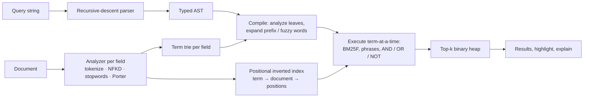

# searchlite

A zero-dependency full-text search engine for TypeScript — BM25F ranking, a real query language,
phrase/prefix/fuzzy search, highlighting, hybrid retrieval and an evaluation harness. Runs in the
browser and Node.

[](https://github.com/ult666666/searchlite/actions/workflows/ci.yml)
[](LICENSE)
[](tsconfig.json)

**Live demo:** <https://ult666666.github.io/searchlite/> — search a 60-entry glossary of software,
data and finance terms in your browser, with highlighted snippets and per-result score
explanations.

## Why

Search libraries are easy to use and hard to explain. searchlite implements the standard
information-retrieval building blocks from their papers — the Porter stemmer, BM25F, positional
phrase matching, Reciprocal Rank Fusion, nDCG — in readable TypeScript with no dependencies, so
every ranking decision can be traced back to a formula. `explain()` shows that formula applied to
any result, and the evaluation harness measures whether a change actually helps.

## Features

- **Analysis per field:** Unicode NFKD normalization with accents stripped, lowercasing, English
  stopwords and a Porter (1980) stemmer; each can be switched off per field (e.g. no stemming for
  tags). Tokens keep positions and source offsets.
- **Positional inverted index** with a document store; `add`, `addAll` (atomic), `remove` and
  `replace` keep document counts and average field lengths exact.
- **BM25F ranking** across weighted fields with configurable `k1` and `b`, and top-k selection with
  a binary heap.
- **Query language** parsed by recursive descent into a typed AST: `AND`/`OR`/`NOT`, `-term`,
  parentheses, `"phrases"`, `field:` scopes, `prefix*` and `fuzzy~1`/`~2`, with error messages
  that give the column.
- **Fuzzy search on a trie**: optimal string alignment distance (insertions, deletions,
  substitutions and adjacent swaps) computed along trie paths with pruning, not by scanning every
  term.
- **Highlighting** of the best-matching window with `<mark>`, HTML-escaped so documents cannot
  inject markup, and **explain()** with a per-clause, per-field score breakdown.
- **Hybrid retrieval:** fuse BM25F with cosine similarity over your own embeddings using
  Reciprocal Rank Fusion.
- **Evaluation:** precision@k, recall@k, MRR, MAP and graded nDCG@k, plus an ablation script.
- **Snapshots:** versioned `toJSON()` / `SearchIndex.fromJSON()`.

## Quick start

searchlite is not published to npm. Install it from the GitHub release (Node 20+; ESM and CommonJS):

```bash
npm install https://github.com/ult666666/searchlite/releases/download/v0.1.0/searchlite-0.1.0.tgz
```

Each release also attaches a SHA-256 checksum. Or build it from source:

```bash
git clone https://github.com/ult666666/searchlite.git
cd searchlite
npm ci
npm run build
# then, from your own project:
npm install ../searchlite
```

```ts
import { SearchIndex, formatExplanation } from 'searchlite';

const index = new SearchIndex({
  fields: { title: { boost: 3 }, body: {}, tags: { boost: 2, stemming: false } },
});

index.addAll([
  {
    id: 'heap',
    title: 'Binary heap',
    body: 'A complete binary tree stored in an array, and the usual way to build a priority queue.',
    tags: ['data-structures'],
  },
  {
    id: 'trie',
    title: 'Trie',
    body: 'A prefix tree that shares common prefixes between strings, used for autocomplete.',
    tags: ['data-structures', 'strings'],
  },
  {
    id: 'npv',
    title: 'Net present value',
    body: 'Future cash flows discounted back to today, minus the initial investment.',
    tags: ['finance'],
  },
]);

for (const result of index.search('priority queue OR prefix*')) {
  console.log(result.id, result.score.toFixed(3), result.terms);
}
console.log(index.highlight('heap', 'body', '"priority queue"'));
console.log(formatExplanation(index.explain('heap', 'priority queue')));
```

Output (from `npx tsx examples/quick-start.ts`, which runs the same code against the source):

```text
heap 1.876 [ 'prioriti', 'queue' ]
trie 1.392 [ 'prefix' ]
A complete binary tree stored in an array, and the usual way to build a <mark>priority queue</mark>.
heap: score 1.876 (k1 = 1.2)
  priority [prioriti] 0.938 = idf 0.981 × saturation(tf̃ 0.923)
    body: tf 1, length 10 (avg 9), boost 1, b 0.75 → 0.923
  queue [queue] 0.938 = idf 0.981 × saturation(tf̃ 0.923)
    body: tf 1, length 10 (avg 9), boost 1, b 0.75 → 0.923
```

`prioriti` is the Porter stem of "priority": documents and queries are analyzed the same way, so
"priorities" would match too.

## Search your local documents

[`examples/search-docs.js`](examples/search-docs.js) is a Node 20+ ESM consumer that imports the
**built public package exports**. From a clone, run this complete offline example:

```bash
npm ci --ignore-scripts
npm run build
mkdir -p .cache
npm run search:docs -- index docs .cache/local-docs.json
npm run search:docs -- search .cache/local-docs.json '"query language"'
```

Replace `docs` with your own small Markdown/text directory and choose a new snapshot filename.
The commands are also available directly through Node:

```bash
node examples/search-docs.js index /absolute/path/to/notes /existing/folder/notes.json
node examples/search-docs.js search /existing/folder/notes.json 'title:deployment OR rollback'
```

`index` creates one document per nonempty UTF-8 `.md` or `.txt` file (extensions are
case-insensitive). IDs are root-relative paths with forward slashes; titles are filenames
without extensions, boosted by 3; bodies contain the complete literal text. Markdown/code is
searchable text. Directory entries are walked in sorted code-unit order, giving deterministic
IDs and tie order. The output is the existing `SearchIndex.toJSON()` format.

`search` restores the saved title/body index with `SearchIndex.fromJSON()` and prints at most
five matches: ID, score, a plain snippet and `formatExplanation()`'s BM25F breakdown. It reads
no original document, so the snapshot remains searchable after those files move or change.
Reindex into a new snapshot to refresh it. Snippets use the first 180 Unicode characters with
whitespace collapsed; control and bidirectional formatting characters are escaped throughout
results, explanations and diagnostics. Source markup remains plain terminal text.

| Bound                                                             | Limit                   |
| ----------------------------------------------------------------- | ----------------------- |
| Each eligible file                                                | 128 KiB                 |
| All eligible file bytes, including whitespace-only files          | 1 MiB                   |
| Eligible `.md`/`.txt` files                                       | 128                     |
| Visited entries, including skipped entries in visited directories | 4,096                   |
| Directory levels below the selected root                          | 16                      |
| Snapshot file                                                     | 16 MiB                  |
| Query                                                             | 1,000 UTF-16 code units |

Hidden entries and symlinks are skipped. These dependency/generated directory names are skipped
case-insensitively: `node_modules`, `bower_components`, `vendor`, `dist`, `build`, `coverage`,
`out`, `output`, `target`, `generated`, `__pycache__`. A selected root inside an excluded path,
linked roots/ancestors/snapshots, nonregular or multiply-linked inputs, invalid UTF-8, NUL text,
and unreadable included inputs are refused. Unsupported extensions and whitespace-only files
are ignored. Failed source scans create no snapshot.

Snapshot parents must already exist. **Existing output files are never overwritten**, including
when the requested output collides with a source document; indexing preserves input bytes.
Search is read-only and leaves malformed snapshots untouched. Exit 0 means success (including
no matches), 1 an input/read/query/snapshot failure, and 2 invalid command arguments. Snapshots
contain the original document text and are historical local data, without freshness or
authenticity guarantees. This is a bounded consumer example for folders you control, not
production filesystem search or protection against a hostile concurrent filesystem owner.
No provider, embedding, browser or internet retrieval is involved.

## Query syntax

| Syntax                                 | Meaning                                                                   |
| -------------------------------------- | ------------------------------------------------------------------------- |
| `cash flow`                            | Either word (OR is the default operator); documents with both rank higher |
| `cash AND flow`                        | Both words                                                                |
| `"cash flow"`                          | The exact phrase (stopword gaps are respected)                            |
| `risk -option`, `risk NOT option`      | Exclude documents that match `option`                                     |
| `(index OR tree) AND disk`             | Grouping; `NOT` binds tighter than `AND`, which binds tighter than `OR`   |
| `title:heap`, `tags:(finance OR risk)` | Restrict a term or a group to one field                                   |
| `hash*`                                | Terms starting with "hash"                                                |
| `volatlity~1`, `teh~2`                 | Terms within 1 or 2 edits (insert, delete, substitute, swap neighbours)   |

Operators must be upper case; `and`, `or` and `not` in lower case are ordinary words. Exclusions
only remove documents, so a query made only of exclusions (`-draft`) returns nothing. Pass
`defaultOperator: 'AND'` to require every word. The full grammar (EBNF) is in
[docs/DESIGN.md](docs/DESIGN.md#5-query-language).

## API overview

| API                                                                                                                            | Purpose                                                                                                                           |
| ------------------------------------------------------------------------------------------------------------------------------ | --------------------------------------------------------------------------------------------------------------------------------- |
| `new SearchIndex(options)`                                                                                                     | `fields` (each with `boost`, `b`, `stemming`, `stopwords`), `storeFields`, `idField`, `vectorField`, `k1`, `b`, `defaultOperator` |
| `add(doc)`, `addAll(docs)`, `remove(id)`, `replace(doc)`                                                                       | Maintain the index; `addAll` is atomic, `replace` keeps the document's tie-break position                                         |
| `search(query, { limit, fields, defaultOperator, maxExpansions })`                                                             | Ranked results: `id`, `score`, stored `fields`, matched `terms`, and `match` (terms per field)                                    |
| `highlight(id, field, query, { maxLength, ellipsis })`                                                                         | HTML snippet of a stored field with `<mark>` around matches                                                                       |
| `explain(id, query)` and `formatExplanation(explanation)`                                                                      | Score breakdown per clause and field; its total equals the `search` score                                                         |
| `searchHybrid({ query, vector, k, depth, rrfK })`                                                                              | BM25F and cosine-similarity rankings fused with Reciprocal Rank Fusion                                                            |
| `toJSON()`, `SearchIndex.fromJSON(data)`, `stats()`, `size`, `has(id)`, `get(id)`                                              | Snapshots and introspection                                                                                                       |
| `parseQuery(text, { defaultOperator, fields })`                                                                                | The typed query AST, e.g. for rewriting queries in a UI                                                                           |
| `evaluate(run, qrels, { k })`, `precisionAtK`, `recallAtK`, `reciprocalRank`, `averagePrecision`, `ndcgAtK`                    | Retrieval metrics                                                                                                                 |
| `Analyzer`, `porterStem`, `tokenize`, `normalizeText`, `osaDistance`, `cosineSimilarity`, `reciprocalRankFusion`, `escapeHtml` | Building blocks, exported for reuse and testing                                                                                   |
| `SearchliteError` (with `code`), `QuerySyntaxError` (with `column`)                                                            | Typed errors thrown for invalid options, documents, queries and snapshots                                                         |

The public API has TSDoc comments that explain the algorithms and cite their sources.

## How it works



Each field is scored with BM25F (Robertson & Zaragoza, 2009): per field,
`B_f = 1 − b_f + b_f · len/avglen`; the weighted, normalized frequencies are summed,
`tf̃ = Σ w_f · tf_f / B_f`, and saturated once, `score = idf · (k1 + 1) · tf̃ / (k1 + tf̃)`.
Phrases are matched by intersecting position lists and scored as single pseudo-terms. Prefix and
fuzzy words expand through the trie and a document scores with its best expansion.
[docs/DESIGN.md](docs/DESIGN.md) covers the data structures, every formula, the grammar, the
trade-offs and how each part is tested.

## Evaluation

`npm run eval` indexes the glossary under several configurations, runs 22 queries and scores the
rankings against graded relevance judgements. Real output:

```text
Corpus: 60 documents, 22 queries, 51 graded judgements (1-3) by the author.
P@5, R@10 and nDCG@10 use those cutoffs; MRR and MAP use the top 100 results.
```

| Configuration                                             | P@5   | R@10  | MRR   | MAP   | nDCG@10 |
| --------------------------------------------------------- | ----- | ----- | ----- | ----- | ------- |
| BM25F, default analysis, boosts title 3 / tags 2 / body 1 | 0.364 | 0.904 | 1.000 | 0.811 | 0.927   |
| no stemming                                               | 0.355 | 0.870 | 0.977 | 0.785 | 0.904   |
| no stopword removal                                       | 0.373 | 0.919 | 1.000 | 0.833 | 0.936   |
| no field boosts (all weights 1)                           | 0.355 | 0.904 | 1.000 | 0.807 | 0.925   |
| single field (title + body + tags as one text)            | 0.364 | 0.904 | 1.000 | 0.811 | 0.925   |
| hybrid: default BM25F + toy trigram vectors, RRF          | 0.382 | 0.904 | 1.000 | 0.843 | 0.935   |

**Read this as a demonstration of the harness, not as a benchmark.** The collection is tiny, I
wrote both the documents and the judgements, and the configurations were fixed before running
them rather than tuned. Most queries have one to three relevant entries, which caps P@5 well
below 1. On this data stemming helps slightly, boosts and BM25F make almost no difference, and
keeping stopwords is marginally better; with 22 queries, differences this small could come from a
single query. The "toy trigram vectors" are hashed character trigrams, which capture spelling
overlap rather than meaning; they exist only to exercise the hybrid code path, and a real
embedding model would be needed to say anything about hybrid retrieval.

## Development

Requires Node 20 or newer (CI runs Node 20, 22 and 24).

```bash
npm ci
npm run lint            # ESLint (typescript-eslint strict + stylistic, type-aware)
npm run format:check    # Prettier
npm run typecheck       # tsc for the tests/scripts, the browser-safe library and the demo
npm run test:coverage   # Vitest; fails below 90% line/branch/function/statement coverage
npm run build           # tsup: ESM + CJS + .d.ts in dist/
npm run check:dist      # loads both builds through package.json "exports"
npm run build:demo      # Vite build of demo/ into demo/dist
npm run eval            # evaluation table above
npm run dev             # demo dev server at http://localhost:5173/searchlite/
```

`npm run check` runs everything CI runs except the evaluation. `.github/workflows/ci.yml` runs
these steps on every push and pull request; `.github/workflows/pages.yml` deploys the demo to
GitHub Pages on pushes to `main` (enable Pages with the "GitHub Actions" source in the repository
settings). Toolchain version choices are explained in
[docs/DESIGN.md](docs/DESIGN.md#15-toolchain-notes).

```text
src/
  analysis/    tokenizer, normalization, stopwords, Porter stemmer, per-field analyzer
  query/       lexer, recursive-descent parser, AST types
  structures/  trie, edit distance, top-k heap
  engine/      field index, query compilation, execution, BM25, highlighting
  search-index.ts, hybrid.ts, evaluation.ts, format.ts, options.ts, errors.ts
test/          unit and property tests (Vitest)
corpus/        glossary documents and judged queries
scripts/       eval.ts, check-dist.js
demo/          Vite web demo
docs/          DESIGN.md
```

## Limitations and roadmap

Limitations:

- Everything lives in memory in a single thread; postings are not compressed, and the only
  persistence is a full JSON snapshot.
- Execution is term-at-a-time over every posting of every clause, which suits collections of
  thousands to tens of thousands of short documents, not millions.
- Analysis is English-oriented: no stemmers for other languages and no segmentation for languages
  written without spaces (a run of Chinese or Japanese characters is a single token).
- Stemming and fuzzy matching interact: a typo can change how the stemmer treats a word, so
  `volatilty~1` misses "volatility" (`volatlity~1` and `volatilty~2` find it).
- Vector search is exact (a linear scan with cosine similarity), and embeddings must be supplied
  by the caller.
- The evaluation collection is small and labelled by one person (see above).

Roadmap:

- A micro-benchmark (`npm run bench`) with a documented method, machine and Node version; it was
  left out of 0.1.0 to keep the scope to features that are fully tested.
- Document-at-a-time execution with WAND/MaxScore skipping, and compressed postings.
- More analyzers (Snowball stemmers, CJK bigrams) and pluggable tokenizers.
- An approximate nearest-neighbour index (e.g. HNSW) for larger vector collections.
- Publishing to npm.

## References

- M. F. Porter. "An algorithm for suffix stripping." _Program_ 14(3), 1980, pp. 130–137.
- S. Robertson and H. Zaragoza. "The Probabilistic Relevance Framework: BM25 and Beyond."
  _Foundations and Trends in Information Retrieval_ 3(4), 2009, pp. 333–389.
- G. V. Cormack, C. L. A. Clarke and S. Büttcher. "Reciprocal Rank Fusion outperforms Condorcet
  and individual Rank Learning Methods." _SIGIR_ 2009.
- K. Järvelin and J. Kekäläinen. "Cumulated gain-based evaluation of IR techniques." _ACM
  Transactions on Information Systems_ 20(4), 2002, pp. 422–446.
- C. D. Manning, P. Raghavan and H. Schütze. _Introduction to Information Retrieval._ Cambridge
  University Press, 2008 (inverted indexes, positional intersection, evaluation measures).

## License

[MIT](LICENSE) © 2026 Charles Dai
