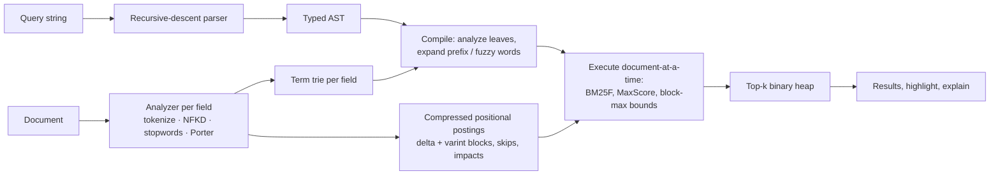

# searchlite design notes

This document explains how searchlite works and why it is built the way it is. It is written to
be read top to bottom by someone who wants to understand (or be quizzed on) every part of the
engine. Code references point at `src/`.

## 1. Goals and non-goals

Goals:

- A small, dependency-free full-text search library that runs unchanged in browsers and Node.
- Ranking that follows the published BM25/BM25F formulas, so every score can be recomputed by hand.
- A real query language with precise error messages.
- Code a strong student can explain line by line: clear data structures over clever tricks.

Non-goals (see "Trade-offs and limitations"): persistence beyond JSON snapshots, sharding,
concurrent writers, language detection, or approximate-nearest-neighbour vector search.

## 2. Module map

The pipeline at a glance:



| Module                                        | Responsibility                                                        |
| --------------------------------------------- | --------------------------------------------------------------------- |
| `analysis/tokenizer.ts`                       | Split text into words with positions and source offsets               |
| `analysis/normalize.ts`                       | NFKD, strip combining marks, lowercase                                |
| `analysis/stopwords.ts`                       | English stopword list                                                 |
| `analysis/porter.ts`                          | Porter (1980) stemmer                                                 |
| `analysis/analyzer.ts`                        | Per-field pipeline: tokenize → normalize → stopwords → stem           |
| `structures/trie.ts`                          | Term dictionary: prefix (breadth-first) and fuzzy (bounded DP) lookup |
| `structures/edit-distance.ts`                 | Optimal string alignment distance                                     |
| `structures/top-k.ts`                         | Binary heap for top-k selection                                       |
| `structures/varint.ts`                        | Variable-byte integers for compressed postings                        |
| `internal/base64.ts`                          | RFC 4648 base64, so snapshots can carry postings bytes in JSON        |
| `query/lexer.ts`, `query/parser.ts`, `ast.ts` | Query language: tokens, recursive-descent parser, typed AST           |
| `engine/field-index.ts`                       | Postings, trie and length statistics for one field                    |
| `engine/postings.ts`                          | Compressed postings: blocks, skip entries, impacts, cursors           |
| `engine/postings-codec.ts`                    | Snapshot (version 2) encoding of postings                             |
| `engine/plan.ts`                              | Compile an AST into an executable plan (analysis + expansion)         |
| `engine/daat.ts`                              | Document-at-a-time top-k: MaxScore with block-max bounds              |
| `engine/execute.ts`                           | Term-at-a-time reference execution, phrases, BM25F, tracing           |
| `engine/bm25.ts`                              | IDF, length normalization, saturation                                 |
| `engine/highlight.ts`                         | Snippet window selection, `<mark>` insertion, HTML escaping           |
| `search-index.ts`                             | Public `SearchIndex` class: documents, search, explain, snapshots     |
| `hybrid.ts`                                   | Cosine similarity and Reciprocal Rank Fusion                          |
| `evaluation.ts`                               | P@k, R@k, MRR, MAP, nDCG@k                                            |

## 3. Analysis pipeline

Every field has its own `Analyzer`, configured with `stemming` (default on) and `stopwords`
(default: the built-in English list; `false` disables; an array replaces it). The same analyzer
processes the field's documents and every query against that field. If they differed, "Indexing"
in a query would never meet "index" in the index.

1. **Tokenize** (`tokenize`). A word is a maximal run of Unicode letters, digits and combining
   marks (`/[\p{L}\p{N}\p{M}]+/gu`). Each word keeps its ordinal `position` and its UTF-16
   `start`/`end` offsets **in the original text**. Offsets are taken before normalization because
   normalization can change length (the ligature "fi" becomes "fi"), and highlighting must mark
   the user's original text.
2. **Normalize** each word: `normalize('NFKD')`, remove `\p{M}` (combining marks), lowercase.
   NFKD splits "é" into "e" + U+0301, so stripping marks makes "café" match "cafe"; the
   compatibility part maps full-width and ligature forms to plain letters.
3. **Remove stopwords.** A removed word keeps its position slot, so in "bank of america" the terms
   `bank` and `america` are two positions apart. Phrase queries rely on this (section 6).
4. **Stem** with Porter (1980): `connected`, `connecting`, `connections` → `connect`.

### Porter stemmer

`porter.ts` follows the 1980 paper, not the later C reference implementation: step 2 has
`abli → able` and no `logi → log`. Its core notions:

- A consonant is a letter other than a, e, i, o, u and other than a `y` that follows a consonant.
- Every word is `[C](VC)^m[V]`; `m` is the _measure_. `tree` has m = 0, `trouble` m = 1,
  `troubles` m = 2. In code, m is the number of vowel→consonant transitions.
- Conditions: `*v*` (stem has a vowel), `*d` (ends in a double consonant), `*o` (ends
  consonant–vowel–consonant, last not w/x/y).
- Within a step only the rule with the **longest matching suffix** is considered; if its condition
  fails the step does nothing (it does not fall back to a shorter suffix). Example: `rational`
  matches `ational` (stem `r`, m = 0, fails), so step 2 leaves it alone even though `tional` would
  have matched.

Words of one or two letters and anything that is not plain `a–z` are returned unchanged.

## 4. Index data structures

```text
SearchIndex
├── fields: FieldIndex[]           one per searchable field, in schema order
│   ├── postings: Map<term, PostingsList>   compressed blocks, see 4.1
│   ├── arena: PostingsArena        one byte buffer shared by the field's small lists
│   ├── dictionary: Trie            same terms, for prefix/fuzzy expansion
│   ├── lengths: number[]           field length per document number
│   ├── totalLength                 Σ field length over documents
│   └── documentCount               documents where the field is non-empty
├── documents: Map<docNumber, { id, lengths[], terms[][], stored, vector? }>
└── numbers: Map<externalId, docNumber>
```

- **Document numbers** are dense integers assigned on insert and never reused for another
  document (a `replace` reuses the replaced document's number so its tie-break order is kept).
  Postings refer to numbers, not string ids, which keeps them compact.
- **Positional postings**: each posting holds a term frequency and the positions; positions
  enable phrases.
- **Forward term lists** (`terms[][]`, distinct terms per field) make removal O(terms in the
  document) instead of a scan of the whole vocabulary.
- **Statistics are maintained incrementally.** `add`, `remove` and `replace` update
  `totalLength`, `documentCount` and the postings in the same operation, and a term whose
  postings become empty is deleted from both the map and the trie. A test checks that an index
  built through adds, removes and replaces has exactly the same statistics and scores as a fresh
  index of the final documents.
- **Atomic batches.** `addAll` validates and analyzes every document before mutating anything, so
  one malformed document leaves the index unchanged.
- **Arrays** (e.g. tags) are analyzed element by element with a position gap of 100 between
  elements, so a phrase cannot match across two tags.

Average field length is computed over documents that have the field (as Lucene does), because a
document without the field never needs normalizing for it.

### 4.1 Compressed postings

Versions up to 0.2.0 kept `Map<docNumber, positions[]>` per term: a hash-table entry and an array
per posting, roughly 80 bytes for a word that occurs once. `PostingsList` (`engine/postings.ts`)
stores the same information with **delta and variable-byte coding** (Manning, Raghavan and
Schütze, 2008, section 5.3):

- Documents are sorted and grouped into **blocks of 128**. Within a block each posting is written
  as the gap from the previous document (the block's first document lives in its skip entry), the
  term frequency, the first position and the gaps between later positions.
- Every number is a **varint** (`structures/varint.ts`): seven bits per byte, lowest first, high
  bit set while more bytes follow, as in Protocol Buffers. Gaps and frequencies are small, so a
  posting of a word that occurs once usually takes three bytes.
- A **skip entry** per block records its first and last document, where its bytes end, its size
  and where its impacts start. `advance(target)` passes over every block whose last document is
  below `target` by reading skip entries only; nothing in a skipped block is decoded.
- **Impacts** (named after Lucene's): per block, the Pareto frontier of (term frequency, field
  length) pairs, the pairs that no other posting in the block beats on both counts. BM25 grows with
  frequency and shrinks with length, so the block's best score is reached at one of these pairs for
  any average length. Section 8 turns them into block-max upper bounds. The frontier is updated in
  O(frontier) on every append, so it never needs a rebuild when the average length changes.
- **Storage.** A `Uint8Array` costs about 200 bytes of headers, more than most rare terms'
  postings, so small lists share one growable buffer per field (`PostingsArena`). A list that
  outgrows its region moves to a larger one at the end, and the region of a term that no longer
  occurs anywhere is abandoned too; when abandoned regions exceed half the buffer (and 64 KiB) the
  arena is compacted, which keeps the copying amortized linear. Lists past 4 KiB move to a buffer
  of their own, where the header cost no longer matters. Skip entries and impacts share one exactly
  sized number array per list.
- **Mutations.** New documents get increasing numbers, so `add` appends to the last block. `remove`
  and the re-insertion done by `replace` (which reuses the old number) rewrite only the block that
  holds the document, splitting it if it grows past 256 documents.
- **Per-document lengths** are also kept per field in a dense array indexed by document number, so
  document-at-a-time scoring reads them without a map lookup.

A model-based property test compares a `PostingsList` with a plain `Map` after hundreds of random
appends, removals and out-of-order re-insertions: decoded contents, block invariants, cursor
`advance` results and every block's frontier (against a brute-force Pareto set).

## 5. Query language

### Grammar (EBNF)

```ebnf
query       = [ or_expr ] ;
or_expr     = and_expr , { ( "OR" | implicit_or ) , and_expr } ;
and_expr    = unary , { ( "AND" | implicit_and ) , unary } ;
unary       = ( "NOT" | "-" ) , unary | primary ;
primary     = "(" , or_expr , ")"
            | FIELD , ":" , ( WORD | PHRASE | "(" , or_expr , ")" )
            | WORD
            | PHRASE ;
WORD        = word-chars , [ "*" | "~" , [ DIGIT ] ] ;
PHRASE      = '"' , { any char except '"' } , '"' ;
FIELD       = ( letter | "_" ) , { letter | digit | "_" } ;
```

`implicit_or`/`implicit_and` stand for juxtaposition (`a b`): it means the index's default
operator (OR unless configured) and binds **at that operator's precedence**. With the default
OR, `a b AND c` is `a OR (b AND c)`; with default AND, `a b OR c` is `(a AND b) OR c`. NOT binds
tightest. Operators are recognized only in upper case; lower-case `and`/`or`/`not` are ordinary
(stop)words.

### Lexing details

- `-` starts an exclusion only at the start of a word (`-draft`); inside a word (`real-time`)
  it is text.
- `name:` is a field scope only when the colon is followed by something other than a space, so
  typing `note: ...` or a half-finished `title:` does not raise an error.
- A word is any run of characters other than whitespace, parentheses and quotes; the field's
  analyzer later decides what the indexable words are.

### Semantics

- **Terms** are analyzed with each searched field's analyzer. If analysis splits a word in two
  (`real-time` → `real`, `time`), it becomes a phrase. If analysis yields nothing (a stopword),
  the clause is dropped: `the AND heap` searches for `heap`, and a query of only stopwords
  returns nothing.
- **Phrases** must match the analyzed terms at the same relative positions, including stopword
  gaps (`"bank of america"` does not match "bank america").
- **NOT / `-` are exclusions, not complements.** A group's result is (its AND/OR over the positive
  children) minus (documents matching any excluded child). `apple OR NOT green` therefore means
  "apple, excluding green", as in Lucene, and a query consisting only of exclusions returns
  nothing. This avoids the surprising "everything except green" reading.
- **Field scopes** apply to a leaf (`title:heap`) or a whole group (`tags:(risk OR finance)`).
  Nested scopes are an error. Unknown field names are reported with the column of the name.
- **Prefix** `word*` and **fuzzy** `word~N` (N ∈ {0, 1, 2}, `~` alone means 1) apply to a single
  word; see section 6.

### Errors and limits

`QuerySyntaxError` carries a 1-based `column` and a message such as
`Missing ")" to close the "(" at column 1 (column 13)`. Queries longer than 2,000 characters and
nesting deeper than 32 levels are rejected, so hostile input cannot exhaust the stack.

## 6. Compiling a query

`compileQuery` turns the AST into a plan of three node kinds:

- `match`: a scored leaf with one _target_ per field: `{ field, terms[], offsets[] }`. A plain
  term has one term and offset 0; a phrase has several terms and their relative positions.
- `alternatives`: the expansions of one prefix or fuzzy word.
- `and` / `or`: children plus an `excluded` list.

**Prefix expansion.** The word is normalized (not stemmed: stems of partial words are
meaningless) and looked up in each field's trie. `withPrefix` walks the subtree breadth-first with
children in sorted order, so it yields the shortest completions first and can stop at
`maxExpansions` (default 64 per field) without visiting the rest. The plan also adds the stem of
the whole word when it is in the index: the index stores `relat` for "relational", which does not
start with "relational", so without this `relational*` would miss documents that contain exactly
"relational". This interaction between stemming and prefix search is easy to miss.

**Fuzzy expansion.** The word is normalized and stemmed (the dictionary contains stems), then
`Trie.fuzzy` finds every term within N edits. Distance is _optimal string alignment_ (OSA):
insertions, deletions, substitutions and swaps of adjacent characters, with no substring edited
twice ("restricted Damerau–Levenshtein"). A swap counts as one edit, which matches real typos
(`teh` → `the`).

The trie search runs the classic dynamic program along trie paths. Row `i` holds the distances
between the current `i`-character prefix and every prefix of the query; each trie edge computes
one new row from the previous one (and the one before it, for swaps). All words sharing a prefix
share those rows. **Pruning:** if every value in a row exceeds N, the subtree is skipped. This is
safe because the minimum of a row never decreases along a path: every cell of row i+1 is derived
from cells of row i plus a non-negative cost, except the swap case, which reads row i−1; but the
swap value `D[i−1][j−2] + 1` is never smaller than `D[i][j−1]` (that cell already considered the
substitution `D[i−1][j−2] + cost` with cost ≤ 1), which is in row i. A property test checks that
the trie returns exactly what a brute-force scan of the dictionary returns.

**Combining expansions.** A prefix or fuzzy word stands for a single word of the query, so a
document scores with its **best** expansion (max), not the sum of all of them. Otherwise a
document mentioning "data", "database" and "dataset" would outrank one that is actually about
databases. Fuzzy expansions are also weighted by `1 / (1 + edits)`, so an exact match beats a
typo-corrected one.

## 7. Scoring: BM25 and BM25F

From Robertson & Zaragoza (2009). For a single field, BM25 scores a term t in document d as

```text
score(t, d) = idf(t) · (k1 + 1) · tf / (k1 · B + tf)
B           = 1 − b + b · len(d) / avglen
```

- **IDF** rewards rare terms. searchlite uses the Lucene variant
  `idf = ln(1 + (N − n + 0.5) / (n + 0.5))` (N documents, n containing the term). The classic
  Robertson–Sparck Jones form omits the `1 +` and turns negative for terms in more than half of
  the documents.
- **Saturation** (`k1`, default 1.2): the second occurrence of a word adds less than the first,
  and the contribution approaches `k1 + 1`. `k1 = 0` gives a binary present/absent model.
- **Length normalization** (`b`, default 0.75): a match in a short field counts more than the
  same match in a long one. `b = 0` disables it.

**BM25F** extends this to several fields. Each field f has a weight `w_f` (the `boost`) and its
own `b_f`. Frequencies are normalized and weighted **per field, then summed, then saturated once**:

```text
B_f    = 1 − b_f + b_f · len(d, f) / avglen(f)
tf̃     = Σ_f  w_f · tf(t, d, f) / B_f
score  = weight · idf(t) · (k1 + 1) · tf̃ / (k1 + tf̃)
```

Saturating after combining is the point of BM25F: a term found in both the title and the body
still saturates towards one limit instead of being rewarded twice, which is what happens if you
add independent per-field BM25 scores (a unit test demonstrates the difference). `weight` is 1
except for fuzzy expansions.

**IDF across fields.** `n` is the number of documents in which the clause matches at least one of
the searched fields (with each field's own analysis), computed from the postings during
execution. For a field-scoped clause it is the number of documents matching in that field.

**Phrases** are scored exactly like terms: their `tf` is the number of times the phrase occurs in
the field and their `n` the number of documents in which it occurs. (Lucene instead sums the
member terms' IDFs; treating a phrase as a pseudo-term keeps one formula for everything.)

**Boolean combination.** A document's score is the sum of the scores of the clauses it matched:
AND adds its children, OR adds the children that matched, exclusions contribute nothing.

## 8. Execution

`search` evaluates **document at a time** (`engine/daat.ts`). Every plan node becomes a scorer: a
cursor over its matching documents in ascending order, with `advance(target)`, the exact `score()`
of its current document, and `shallow(target)`, which returns an upper bound on the score of any
document from `target` to the end of the current blocks. Term clauses walk their targets'
postings lists (one per field) together; AND is a leapfrog intersection led by its cheapest child;
OR and prefix/fuzzy alternatives are unions; groups with exclusions skip documents that an excluded
plan matches.

**Clause statistics come first.** BM25F's IDF needs the number of documents in which a clause
matches any of its fields, before a single document is scored. For one field that is the list's
length. For several, `unionSize` counts the union by walking the smaller lists and probing the
largest with `advance`, so the largest list's blocks that hold none of those documents are never
decoded. A phrase's document frequency requires positional matching anyway, so phrase clauses are
evaluated up front (as before) and become a sorted list with exact scores and per-128-document
maxima.

**MaxScore** (Turtle and Flood, 1995) for a top-level OR, run in windows as Lucene's
`MaxScoreBulkScorer` does. A window ends at the first block boundary of any child, so each child's
block-max bound (Ding and Suel, 2011) holds for the whole window. With θ the k-th best score so
far:

1. Sort the children by their window bounds. The longest prefix whose bounds add up to at most θ
   is **non-essential**: a document matching only those children cannot beat θ. If every child is
   non-essential, the window is skipped without decoding anything.
2. Candidates come from the essential children only. A candidate whose essential bounds plus all
   non-essential bounds cannot beat θ is dropped before any exact scoring.
3. Otherwise the essential children's exact scores are added, then the non-essential children are
   consulted from the highest bound down, stopping as soon as the partial score plus the remaining
   bounds cannot beat θ.
4. A surviving document's final score is computed by adding the children's exact scores **in query
   order**, which is how term-at-a-time execution adds them.

Other root shapes (one clause, AND, alternatives) use the same windows with the root's own bound,
so whole windows that cannot compete are skipped. A block's bound for a term clause is
`weight · idf · saturate(Σ_f max over its impacts of boost_f · tf / B_f(len), k1)`, computed with the
query's current average lengths.

**Why the results are exactly the same.** Each scored document gets the same floating-point
operations, in the same order, as `executePlan` would apply, so scores are equal bit for bit, not
just close. A document is dropped only when a bound shows it cannot enter the top k. Bounds are
mathematically at least the score, but they are computed with different rounding (sums in a
different order, and `(k1 + 1)·f / (k1 + f)` is not monotone to the last bit), so every comparison
uses `bound · (1 + 1e-9) + 1e-300 > θ`. That margin is many orders of magnitude above the few units
in the last place that rounding can introduce, so a competitive document is never pruned. A test
builds a case where the margin decides the result: two documents add the same three clause scores
in different orders, one unit in the last place apart, and without the margin the later, higher
one is skipped. Documents are visited in ascending order, and a later document with a score equal
to θ already loses the tie to every document kept, so insertion order still breaks ties.
Parameters that make a bound infinite or NaN (an enormous `k1` or boost) fall back to exhaustive
term-at-a-time scoring.

**Filters and exclusions** are checked only for documents that would otherwise enter the top k, in
ascending order. A rejected document never enters the heap, so it never raises θ; applying a
filter after selecting the top k would return fewer than k results.

**Term-at-a-time execution** (`executePlan`) remains the reference. `explain`, `highlight` and the
matched terms of each result run it for single documents, reusing the clause statistics that the
search computed, so a single document is looked up in each list (one block decoded) instead of
materializing occurrence tables. The candidate-aware AND and exclusion behaviour described in
[EXECUTION.md](EXECUTION.md) still applies there.

**Phrase matching** uses positional intersection: the candidate documents come from the rarest
term's postings, and for each document the position lists are scanned with one cursor per term.
Candidate start positions only increase, so every cursor only moves forward and a document costs
O(total positions). As soon as one list runs out, no later start can match and the scan stops.

**Top-k selection** uses a min-heap of size k whose root is the _worst_ kept result: a new result
only has to beat the root, replacing it and sifting down. The root's score is θ in MaxScore. Selecting k of n matches is
O(n log k) time and O(k) memory instead of sorting all n. Ties are broken by document number
(insertion order), so results are deterministic.

**Matched terms and explanations** come from re-executing the plan for one document with tracing
on (`only` + `trace` in the execution context). Document frequencies and phrase occurrence tables
are cached per query, so re-execution does not repeat the postings scans. Because search and explain
run the same code in the same order, `explain(id, q).score === search(q)[i].score` exactly; a test
asserts this equality (not just closeness) for many queries.

## 9. Highlighting

`highlight(id, field, query)`:

1. Re-analyzes the stored field text to get tokens with their original offsets.
2. Takes, from the document's trace, only the clauses that actually contributed to its score, so
   a term inside a failed `AND` group is not marked.
3. Marks tokens: every occurrence of a single-term target, but for a phrase only the tokens that
   form an occurrence of the phrase.
4. Chooses the window with **two pointers** over the marked tokens: for each mark as the left
   edge, extend right while the span fits in `maxLength`; keep the window with the most distinct
   terms, then the most marks. Leftover room is split between context before and after, cut at
   word boundaries, with an ellipsis where text is omitted.
5. Builds HTML. **Every** piece of document text, the ellipsis included, goes through
   `escapeHtml` (`& < > " '`); the only markup added is `<mark>`/`</mark>`, and neighbouring marks
   separated only by spaces are merged ("`<mark>binary heap</mark>`"). Tests feed in
   `<script>`/`` documents, HTML in queries and in the ellipsis, strip the `<mark>`
   tags from the output and assert no `<` or `>` remains.

## 10. Hybrid retrieval

Documents may carry an embedding in `vectorField`. `searchHybrid({ query, vector, k })` builds two
rankings: BM25F for the query, and exact cosine similarity (`dot(a, b) / (|a| · |b|)`) between
the query vector and every stored vector. It fuses them with **Reciprocal Rank Fusion**
(Cormack, Clarke & Büttcher, 2009):

```text
RRF(d) = Σ_rankings 1 / (k + rank(d))      (ranks start at 1, k = 60 by default)
```

RRF uses only ranks, so it can merge BM25 scores and cosine similarities, which live on
incompatible scales, without any score normalization. The constant k damps the advantage of the
very top ranks. Unit tests check fused scores against hand-computed sums.

searchlite does not compute embeddings; you bring vectors from any model. The evaluation script
uses a toy character-trigram hashing vectorizer only to exercise the code path.

## 11. Evaluation metrics

`evaluate(run, qrels, { k })` scores rankings against graded judgements (grade > 0 = relevant):

- **Precision@k** = relevant results in the top k / k.
- **Recall@k** = relevant results in the top k / all relevant documents.
- **Reciprocal rank** = 1 / rank of the first relevant result (0 if none); its mean is MRR.
- **Average precision** = Σ over relevant results at rank r of precision@r, divided by the number of
  relevant documents (unretrieved ones contribute 0); its mean is MAP.
- **nDCG@k** (Järvelin & Kekäläinen, 2002) = DCG@k / IDCG@k, with
  `DCG@k = Σ_{i=1..k} grade_i / log2(i + 1)` and IDCG the DCG of the ideal ordering of all judged
  documents. Gains are the grades themselves (linear). The `log2(i + 1)` discount is the form
  used by trec_eval; the original paper leaves the first ranks undiscounted.

P@k, R@k and nDCG@k use the cutoff; MRR and MAP use the full ranking supplied. Repeated ids in a
ranking count once. Every metric has a unit test with hand-computed values.

## 12. Snapshots

`toJSON()` returns plain data. For `new SearchIndex({ fields: { title: { boost: 3 } } })`
holding the single document `{ id: 'heap', title: 'Binary heap' }`, `JSON.stringify(index)`
produces (line breaks added):

```json
{
  "format": "searchlite",
  "version": 2,
  "options": {
    "fields": [{ "name": "title", "boost": 3, "b": 0.75, "stemming": true, "stopwords": true }],
    "storeFields": ["title"],
    "idField": "id",
    "k1": 1.2,
    "b": 0.75,
    "defaultOperator": "OR"
  },
  "documents": [{ "id": "heap", "lengths": [2], "stored": { "title": "Binary heap" } }],
  "postings": {
    "title": [
      ["binari", "AQEA"],
      ["heap", "AQEB"]
    ]
  }
}
```

Documents are written in document-number order and postings refer to their position in that
array (their _slot_), so restoring preserves tie-break order. Each term's postings are base64
(RFC 4648) of varints: for each document holding the term, the gap from the previous slot (the
first counts from -1), the frequency, the first position and the gaps between later positions.
`AQEA` is the bytes 01 01 00: slot 0, frequency 1, position 0.

`fromJSON` checks `format` and `version` first (an unknown version fails with a clear message
instead of misreading data), validates the shape, and rebuilds through the same `addDocument` path
that indexing uses, so statistics are recomputed rather than trusted. Payloads are decoded
strictly: invalid base64, truncated or non-canonical varints, slots that do not increase or point
past the documents, zero frequencies and positions that do not increase are all rejected.

**Version 1** (searchlite 0.2.0 and earlier) stored the same postings as JSON arrays,
`["heap", [[0, [1]]]]`. `fromJSON` still reads it, so migrating a stored snapshot is
`SearchIndex.fromJSON(old).toJSON()`. A fixture written by the 0.2.0 build
(`test/fixtures/snapshot-v1.json`, regenerated with `scripts/snapshot-v1-fixture.ts`) stores both the
snapshot and the results that build returned for 14 queries; the test requires the current build
to return the same results, scores included, from the migrated index and from its version 2
round trip. A round-trip test compares search results, explanations, highlights and statistics
before and after.

## 13. Trade-offs and limitations

- **Memory-resident and single-threaded.** Postings are compressed in memory (section 4.1), but
  there is no on-disk format besides the JSON snapshot.
- **Clause statistics are exact, so some work is not skippable.** Multi-field clauses count the
  union of their lists before scoring, and phrases are matched in full for their document
  frequency. Lucene approximates both (its `CombinedFieldQuery` uses the largest per-field
  document frequency); searchlite keeps the exact BM25F definition and pays for it.
- **MaxScore, not WAND.** Block-max WAND (Ding and Suel, 2011) can skip more on long disjunctions
  of similar terms. Pruning only helps once k results are found, so `limit: Infinity` scores every
  match, and with `k1 = 0` (all clause scores tied) the safety margin prevents most skipping.
- **Wide expansions.** A prefix or fuzzy word is a union of its expansions, and the union's
  `advance` and `score` visit every expansion for each document, so its cost grows with documents
  times expansions. The default `maxExpansions` of 64 keeps this small; a much larger limit can be
  slower than term-at-a-time execution, which costs only the total postings length. A heap-ordered
  union would remove the factor.
- **Block rewrites.** `remove` and `replace` rewrite a block and move later bytes in its list, so
  they cost O(list bytes) rather than O(1); the shared arena trades up to about half its size in
  abandoned regions for fewer object headers.
- **English-only analysis.** No CJK segmentation (a run of CJK characters is one token), no
  stemming for other languages; letters like "ø" that do not decompose are not folded to ASCII.
- **Stemming interacts with fuzzy search.** A typo can change how Porter treats a word, so
  `volatilty~1` (missing "i") misses `volatility` while `volatlity~1` finds it; `~2` covers both.
- **Exact vector search** is a linear scan; fine for thousands of vectors, not millions.
- **No incremental snapshot**: `toJSON` serializes the whole index.

Roadmap:

- Block-max WAND for long disjunctions, and an on-disk index format.
- More analyzers (Snowball stemmers, CJK bigrams) and pluggable tokenizers.
- An approximate nearest-neighbour index (for example HNSW) for larger vector collections.
- Publishing to npm.

## 14. How correctness is verified

| Area            | Test approach                                                                                                                                                       |
| --------------- | ------------------------------------------------------------------------------------------------------------------------------------------------------------------- |
| Porter stemmer  | Every worked example in the 1980 paper, run through the full algorithm, plus well-known pairs                                                                       |
| Analysis        | Offsets slice back to the original text; NFKD, ligatures, full-width forms, dotted capital I                                                                        |
| Edit distance   | Hand-computed distances, including the OSA-specific `ca` → `abc` = 3                                                                                                |
| Trie fuzzy      | Property test: 100 random queries vs a brute-force scan of a dictionary of 400 random words                                                                         |
| Top-k heap      | Property test: 200 random arrays vs a full sort                                                                                                                     |
| BM25 / BM25F    | Hand-computed scores for single-field and two-field indexes; b = 0 and k1 = 0 special cases                                                                         |
| Query semantics | AND/OR/NOT, default operator, stopword clauses, phrases with gaps, prefix/fuzzy expansion and limits                                                                |
| Parser          | AST shapes and 19 error messages with exact columns; depth and length limits                                                                                        |
| Index lifecycle | Incremental statistics equal a fresh rebuild after removes/replaces; atomic batches; validation errors                                                              |
| Explain         | `explain().score` equals `search()` score exactly; clause scores sum to the total                                                                                   |
| Highlighting    | Hostile HTML in documents, queries and the ellipsis cannot inject markup; phrase-only marking                                                                       |
| Hybrid          | RRF and cosine against hand computations; end-to-end fused order on a toy index                                                                                     |
| Metrics         | P@k, R@k, RR, AP, nDCG@k against hand computations                                                                                                                  |
| Snapshots       | Round trip equality; malformed or future-version rejection; a 0.2.0 version 1 fixture gives identical results                                                       |
| Codecs          | Protocol Buffers varint examples, RFC 4648 base64 vectors, Node's `Buffer` as a reference, strictness                                                               |
| Postings        | Model-based property test against a `Map`: contents, blocks, cursors, impact frontiers, arena compaction                                                            |
| Top-k pruning   | Property tests: pruned top k equals exhaustive scoring (IDs, order, exact scores) over random corpora, queries, filters and mutations; deliberate bugs make it fail |
| Build output    | `scripts/check-dist.js` loads the ESM and CJS builds through the `exports` map                                                                                      |

## 15. Toolchain notes

- **TypeScript 6.0**, not 7: typescript-eslint 8 supports TypeScript `<6.1`, and TypeScript 7 (the
  native port) does not yet expose the API that typed linting and declaration bundling use.
- **Vitest 4 and tsup 8**, not Vitest 5 / tsup 9: both newer majors require Node ≥ 22, and CI
  tests Node 20, 22 and 24.
- **tsup 8 + TypeScript 6** needs `ignoreDeprecations: "6.0"` in the declaration build only,
  because tsup passes the deprecated `baseUrl` option internally (see `tsup.config.ts`).
- **`overrides.esbuild`**: tsup 8 pins esbuild 0.27, which has a low-severity advisory affecting
  its development server on Windows (not used here); the override moves the whole tree to the
  fixed 0.28 line. The build and the dist smoke test pass with it.
- **ESLint 10** with flat config and `typescript-eslint`'s `strictTypeChecked` +
  `stylisticTypeChecked` presets.

## 16. Questions worth being able to answer

- Why does BM25 saturate term frequency, and what do k1 and b control?
- Why combine fields before saturation (BM25F) instead of summing per-field BM25 scores?
- Why can the classic RSJ IDF go negative, and how does the `1 +` fix it?
- Why must documents and queries go through the same analyzer? What breaks for prefix queries on
  stemmed fields, and how does searchlite handle it?
- How does positional intersection count phrase matches in linear time? Why keep stopword gaps?
- Why is the trie fuzzy search allowed to prune a subtree when the row minimum exceeds N?
- What is the difference between Levenshtein, OSA and unrestricted Damerau–Levenshtein distance?
- Why a min-heap of size k for top-k, and what is the complexity?
- Why does RRF work without normalizing scores? What does its k parameter change?
- Why is NOT an exclusion rather than a complement? What does `-draft` alone return?
- How does the highlighter guarantee no HTML injection?
- What do P@5, MRR, MAP and nDCG@10 each reward, and why is a 22-query, single-annotator collection
  not evidence that one configuration is better?
- Why can MaxScore ignore non-essential clauses when choosing candidates? What changes when θ grows?
- Why are block bounds computed from a Pareto frontier of (frequency, length) instead of the
  largest frequency and the shortest length? Why not store the best score itself?
- Why must pruned results add clause scores in query order, and why do bounds need a margin?
- Why does a filter have to run before a document enters the heap?

## 17. References for pruning and compression

- H. Turtle and J. Flood. "Query evaluation: Strategies and optimizations." _Information Processing
  & Management_ 31(6), 1995, pp. 831–850. [doi:10.1016/0306-4573(95)00020-H](<https://doi.org/10.1016/0306-4573(95)00020-H>)
  (MaxScore).
- S. Ding and T. Suel. "Faster top-k document retrieval using block-max indexes." _SIGIR_ 2011,
  pp. 993–1002. [doi:10.1145/2009916.2010048](https://doi.org/10.1145/2009916.2010048) (block-max
  bounds; also block-max WAND, which searchlite does not implement).
- A. Z. Broder, D. Carmel, M. Herscovici, A. Soffer and J. Zien. "Efficient query evaluation using a
  two-level retrieval process." _CIKM_ 2003, pp. 426–434.
  [doi:10.1145/956863.956944](https://doi.org/10.1145/956863.956944) (WAND, for comparison).
- Apache Lucene,
  [`MaxScoreBulkScorer`](https://github.com/apache/lucene/blob/main/lucene/core/src/java/org/apache/lucene/search/MaxScoreBulkScorer.java)
  (MaxScore in windows) and
  [`Impact`](https://lucene.apache.org/core/9_0_0/core/org/apache/lucene/index/Impact.html)
  (per-block frequency and norm pairs).
- C. D. Manning, P. Raghavan and H. Schütze. _Introduction to Information Retrieval._ Cambridge
  University Press, 2008, section 5.3 (variable byte codes and gap encoding).
- [Protocol Buffers encoding](https://protobuf.dev/programming-guides/encoding/) (base-128 varints)
  and [RFC 4648](https://www.rfc-editor.org/rfc/rfc4648) (base64).

## 18. References for ranking and evaluation

- M. F. Porter. "An algorithm for suffix stripping." _Program_ 14(3), 1980, pp. 130–137.
- S. Robertson and H. Zaragoza. "The Probabilistic Relevance Framework: BM25 and Beyond."
  _Foundations and Trends in Information Retrieval_ 3(4), 2009, pp. 333–389.
- G. V. Cormack, C. L. A. Clarke and S. Büttcher. "Reciprocal Rank Fusion outperforms Condorcet
  and individual Rank Learning Methods." _SIGIR_ 2009.
- K. Järvelin and J. Kekäläinen. "Cumulated gain-based evaluation of IR techniques." _ACM
  Transactions on Information Systems_ 20(4), 2002, pp. 422–446.
- C. D. Manning, P. Raghavan and H. Schütze. _Introduction to Information Retrieval._ Cambridge
  University Press, 2008 (inverted indexes, positional intersection, evaluation measures).
